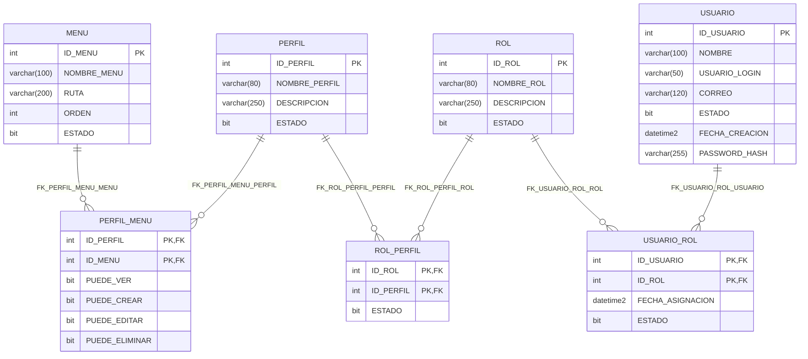

# MER final sqlserver

Verificado el 2026-11-07 contra metadatos de la base. Tipos, claves y nulabilidad completos en [el catalogo](final/sqlserver-schema.json).

[PDF final](final/MER-sqlserver-final.pdf) | [SVG](final/sqlserver.svg) | [Fuente DOT](final/sqlserver.dot) | [Fuente Mermaid](final/sqlserver.mmd)

Sin FK entre motores. La auditoria se registra desde la aplicacion; no se crean triggers. USUARIO de Oracle representa responsables funcionales; USUARIO de SQL Server autentica cuentas de aplicacion.
